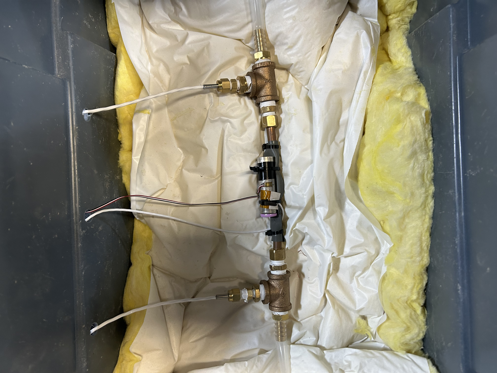

# three-cell-independent-conduction-nhr-4960
* Cabinet-based NHR 9200 system with three independent 4960 power modules.
* Configured for individual cell testing, with one cell connected to each channel.
* Cells are placed in insulated test enclosures and maintained at the target temperature using forced-water cooling.
* Each channel is rated for up to 600 V DC, 40 A, and 12 kW.

  
   
  <em>Figure 1. Test setup.</em>

## Versions

# V0.1
The inital version that was in the lab in August 2026.